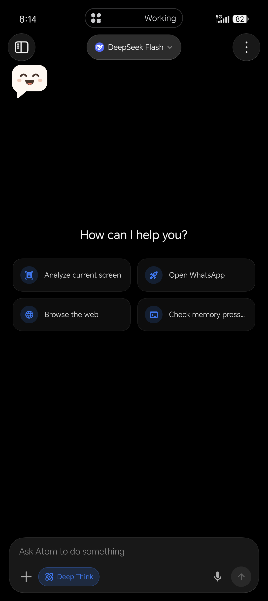

# Atom

**A system-level AI agent for Android.** Answer questions, control your phone, code in a terminal, and chat from a floating bubble — one app.

## Highlights

- **Floating Atom bubble** — an always-on glowing nucleus with orbiting electrons and electric arcs. Tap it to open a floating mini-chat, drag it anywhere, hide it or talk to it.
- **True OLED black** — a real `#000000` theme, on by default in dark mode.
- **English-first** — every string, prompt, and tool description is English.
- **System-level control** — accessibility-driven screen reading and tapping, plus Root for deep control: brightness, volume, Wi-Fi, app freeze, protected settings, system logs.
- **Background virtual display** — run cross-app tasks silently on a hidden screen (Root / LSPosed).
- **Circle to Search** — circle anything on screen to search it (LSPosed module).
- **Terminal + Linux** — a full mobile PTY terminal with Alpine/Debian Linux for on-device coding.
- **Personal context** — notifications, SMS/OTP, calendar, contacts, photos, recordings, bills, orders, notes.
- **Any model** — OpenAI, Anthropic, Gemini, DeepSeek, Qwen, Grok, and more; bring your key or use a subscription.
- **Privacy hardened** — no telemetry SDKs, no third-party download proxies, its own update channel.

## Features

### Agent & automation
- Parallel subagents, scheduled tasks, cross-app GUI control, AI image generation, web search and a built-in browser.
- Skills, MCP tools, long-term memory, and Tavern character roleplay.

### Interface
- Miuix and COUI native styles, OLED pure black, the floating bubble + mini chat, and native LaTeX rendering.

### Voice
- Push-to-talk and read-aloud, streaming ASR/TTS across multiple providers.

## Install

Download the signed APK from [Releases](https://github.com/namanwtf/atom/releases), or build it with CI (`.github/workflows/ci.yml`).

## Requirements

Android 14+. Root and LSPosed unlock the virtual display and the deepest system features; the core works without root.

## License

GPL-3.0 — see [LICENSE](LICENSE). Built on the open-source agent [Eta](https://github.com/Mangi-11/Eta) by Mangi-11.
